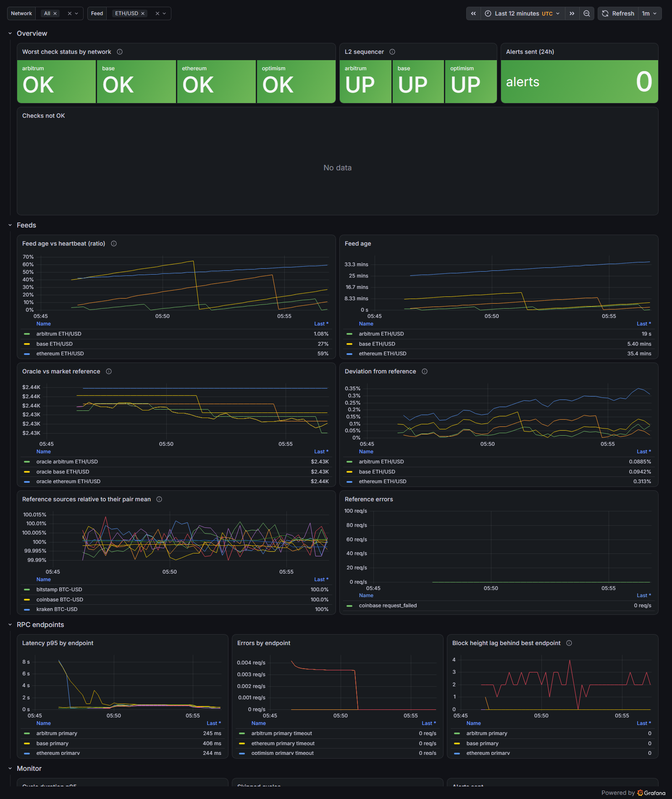

# oraclewatch

Consumer-side monitoring for Chainlink Data Feeds: a Go daemon that reads the feeds your
protocol depends on directly from the chain, and alerts when the assumptions your contracts
make about them stop holding.

[](https://github.com/brennocm/oraclewatch/actions/workflows/ci.yml)
[](https://github.com/brennocm/oraclewatch/releases)
[](https://goreportcard.com/report/github.com/brennocm/oraclewatch)
[](https://scorecard.dev/viewer/?uri=github.com/brennocm/oraclewatch)
[](LICENSE)




> Not affiliated with Chainlink Labs. Not financial advice.

## Why

Chainlink operates and monitors its Data Feeds. The risk of *using* a feed, though, sits with
the protocol that consumes it: a lending market that values collateral with a feed has
written code that assumes the price is fresh, within sane bounds, published while the L2
sequencer was up, and close to the market. When one of those assumptions breaks, the
protocol is the one that loses money.

Auditors ask for these checks on-chain (`updatedAt` freshness, `answer > 0`, sequencer
uptime and grace period). oraclewatch runs the same checks, and a few more that only make
sense off-chain, continuously, and pages a human:

- **LUNA/USD, May 2022.** The market fell below the aggregator's `minAnswer`; out-of-range
  reports are rejected, so the feed froze at about $0.107 while LUNA traded around $0.01.
  Venus and Blizz Finance lost about $11M and $8.3M. `FW-DEV-001` (≈970% deviation),
  `FW-STALE-001` and `FW-CB-001` flag that condition.
- **Moonwell wrsETH, November 2025.** An exchange-rate feed reported 1 wrsETH = 1.65M ETH;
  the attack took 30 seconds. `FW-JUMP-001` flags the jump, and the case shows why a monitor
  complements, and does not replace, on-chain sanity bounds.
- **Arbitrum sequencer outage, December 2023.** About 78 minutes of downtime. Prices cannot
  update while the sequencer is down, and queued transactions run first when it returns:
  `FW-SEQ-001`, `FW-SEQ-002` and `FW-CHAIN-001`.

Sources and the full analysis, including a case oraclewatch would **not** catch, are in
[docs/incidents.md](docs/incidents.md).

## Checks

<!-- checks:start -->
| ID | Check | Max severity | Detects | Status |
|---|---|---|---|---|
| [`FW-STALE-001`](docs/checks/FW-STALE-001.md) | Feed stale | critical | no update within heartbeat + tolerance (block time) | stable |
| [`FW-INVALID-001`](docs/checks/FW-INVALID-001.md) | Invalid round data | critical | answer <= 0, zero timestamps, updatedAt after the block, roundId going backwards | stable |
| [`FW-DEV-001`](docs/checks/FW-DEV-001.md) | Deviation from market reference | critical | oracle vs median of USD exchange mids | stable |
| [`FW-REF-001`](docs/checks/FW-REF-001.md) | Reference degraded | warning | too few exchanges answered or they disagree; suppresses FW-DEV-001 | stable |
| [`FW-CB-001`](docs/checks/FW-CB-001.md) | Near circuit-breaker bound | critical | answer close to minAnswer/maxAnswer (verified aggregator types only) | stable |
| [`FW-AGG-001`](docs/checks/FW-AGG-001.md) | Aggregator changed | info | proxy points to a new aggregator or phase | stable |
| [`FW-META-001`](docs/checks/FW-META-001.md) | Metadata drift | critical | decimals/description differ from config, version changed | stable |
| [`FW-JUMP-001`](docs/checks/FW-JUMP-001.md) | Abrupt round-to-round change | warning | implausible jump between observed rounds | experimental (off by default) |
| [`FW-RPC-001`](docs/checks/FW-RPC-001.md) | RPC disagreement | critical | endpoints return different data at the same block hash | stable |
| [`FW-CHAIN-001`](docs/checks/FW-CHAIN-001.md) | Chain head stalled / RPC lagging | critical | endpoint head older than max_head_lag | stable |
| [`FW-RPC-002`](docs/checks/FW-RPC-002.md) | RPC fork view | warning | endpoint has a different hash for the pinned block | stable |
| [`FW-RPC-003`](docs/checks/FW-RPC-003.md) | Wrong chain | critical | eth_chainId differs from config; endpoint disabled | stable |
| [`FW-SEQ-001`](docs/checks/FW-SEQ-001.md) | L2 sequencer down | critical | sequencer uptime feed answer == 1 or invalid | stable |
| [`FW-SEQ-002`](docs/checks/FW-SEQ-002.md) | L2 sequencer grace period | warning | sequencer recovered less than grace_period ago | stable |
| [`FW-SELF-001`](docs/checks/FW-SELF-001.md) | Monitor blind | critical | no successful reads (or no reference) for N cycles | stable |
| [`FW-XCHAIN-001`](docs/checks/FW-XCHAIN-001.md) | Cross-chain divergence | warning | same pair differs across networks beyond both thresholds + margin | stable |
<!-- checks:end -->

Each check links to its documentation: exact logic, rationale, parameters, known false
positives. The research behind them, including what was confirmed in the deployed
aggregator source (for example that out-of-range reports revert instead of clamping), is in
[docs/research.md](docs/research.md). This table is generated from the code and a test
fails if it drifts.

## Quick start

```sh
cp .env.example .env            # RPC URLs (two providers per network), notifiers, Grafana password, domain
make build && set -a && . ./.env && set +a
./bin/oraclewatch check --config configs/example.yaml
```

`check` runs one cycle on every network and exits `0` (fine), `1` (a result at or above
`--fail-on`, default `critical`) or `2` (error), so it can run from CI or cron. For the
daemon with Prometheus, Grafana and TLS:

```sh
docker compose -f deploy/docker-compose.yml --env-file .env up -d
```

Other commands: `oraclewatch run` (daemon), `validate-config [--online]`, `feeds list`,
`version`. See [docs/DEPLOYMENT.md](docs/DEPLOYMENT.md) for an Oracle Cloud Always Free
deployment on arm64.

## What is monitored

[`configs/example.yaml`](configs/example.yaml) monitors ETH/USD, BTC/USD and USDC/USD on
Ethereum, Arbitrum, Base and OP Mainnet, plus the L2 sequencer uptime feeds of the three
L2s. Every address was taken from the data files the official addresses page loads and
verified on-chain against two RPCs at the same block
([docs/research.md §4](docs/research.md#4-on-chain-verification)); a test keeps the example
identical to the verified lists in [`configs/feeds/`](configs/feeds).

**Why Polygon is not included.** Polygon PoS has no L2 sequencer uptime feed (the sequencer
checks, which are among the most important for L2 consumers, would not apply), and v1
concentrates on four networks so that each check is exercised on every one of them. Adding
Polygon is a matter of generating and verifying `configs/feeds/polygon.yaml` and adding a
network block; nothing in the code is network-specific.

## Configuration

Annotated example: [`configs/example.yaml`](configs/example.yaml). The essentials:

- Secrets (RPC URLs, webhook, bot token) are `${VAR}` references, expanded from the
  environment **only** in secret fields, never logged, never exported.
- Unknown keys are errors; percentages need `%`; addresses need a valid EIP-55 checksum;
  every problem is reported at once with its field path.
- Every check parameter has a default from the research and can be overridden per feed.

## Architecture

One goroutine per network, each running cycles on a ticker: pin one block
(`min(head) - confirmations`), read every feed on every endpoint **at that block**, fetch the
market reference, evaluate the checks (pure functions, exact `math/big` arithmetic), and feed
an alert state machine with `for:`, hysteresis, cooldown and storm grouping.
[docs/ARCHITECTURE.md](docs/ARCHITECTURE.md) has the diagram, the concurrency model and how
to add a check or a network; design decisions are recorded in [docs/adr](docs/adr).

## Security

- **Read-only by construction.** Only `eth_chainId`, `eth_getBlockByNumber` and `eth_call`.
  No private key exists in the program, and a test fails if the binary links any key
  management or transaction-signing package.
- **No single point of trust.** Several RPCs per network compared byte-for-byte at the same
  block hash (`FW-RPC-001`), chain ID verification (`FW-RPC-003`), median of several
  exchanges with an explicit "untrusted" state (`FW-REF-001`).
- **Secrets never leave the process.** Redaction of strings, errors (including `*url.Error`)
  and logs, verified by an end-to-end test across logs, metrics, `/status` and alerts.
- **Supply chain.** Minimal dependencies, actions pinned by SHA, Dependabot, signed release
  images with SBOM and build provenance.

Threat model: [docs/THREAT_MODEL.md](docs/THREAT_MODEL.md). Reporting: [SECURITY.md](SECURITY.md).

## Limitations

- **Detection latency is the poll interval** (default 60 s) plus confirmations. An attacker
  watching the same feed acts within a block; oraclewatch tells humans, it does not stop
  transactions.
- **It does not replace on-chain validation** in the consumer contract. Checks belong in the
  contract first; this is the second line.
- It monitors raw feeds, not a protocol's derived prices: a consumer that composes feeds
  wrongly (Moonwell cbETH, 2026) is out of scope.
- It is only as good as its inputs: with every RPC or every exchange failing it reports
  itself blind (`FW-SELF-001`) instead of guessing.
- State (firing alerts, previous rounds) is in memory; a restart re-alerts conditions that
  persist and forgets ones that cleared ([ADR 0007](docs/adr/0007-in-memory-alert-state.md)).
- Heartbeats and deviation thresholds are off-chain parameters copied from the official data
  files; if Chainlink changes them, update the feed files.

## Development

```sh
make test-race         # unit tests
make test-integration  # go-ethereum simulated backend + Solidity test doubles
make lint vuln fuzz
MAINNET_RPC_URL=... make test-fork   # Anvil mainnet fork
```

See [CONTRIBUTING.md](CONTRIBUTING.md).

## Disclaimer

oraclewatch is an independent project and is not affiliated with, endorsed by or sponsored
by Chainlink Labs. "Chainlink" is used only to describe the data feeds this tool reads. The
software is provided as is; it is not financial advice and does not guarantee the detection
of any event.

## License

[Apache-2.0](LICENSE)
