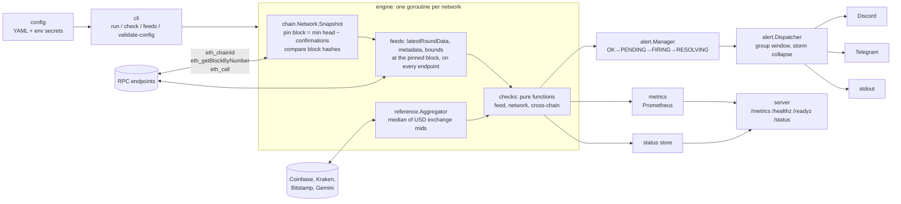

# Architecture

## Overview

Package map:

| Package | Responsibility |
|---|---|
| `internal/config` | Strict YAML loading, secret-only `${VAR}` expansion, defaults, validation with field paths. |
| `internal/redact` | Removes registered secrets from strings, errors (`*url.Error` always rewritten) and `slog` records. |
| `internal/chain` | Endpoints (timeouts, retries, circuit breaker, chain ID check) and the per-network pinned-block snapshot. |
| `internal/feeds` | `eth_call` encoding/decoding of the feed ABIs (embedded), rounds, metadata, bounds, normalisation. |
| `internal/reference` | Exchange clients and the median/spread aggregator. |
| `internal/checks` | The check catalog. Pure functions of their input, exact `math/big` arithmetic. |
| `internal/engine` | Scheduling, one cycle per network per tick, cross-chain store, status store. |
| `internal/alert`, `alert/notify` | Alert state machine, dispatcher, Discord/Telegram/stdout. |
| `internal/metrics`, `internal/server` | Prometheus metrics (bounded labels) and the HTTP endpoints. |
| `internal/cli` | Commands; wiring only. |

Dependencies point inwards: `checks` knows nothing about RPCs or HTTP; `chain` and `feeds`
know nothing about checks or alerts; only `cli` knows everything.

## Concurrency model

- `engine.Run` starts one goroutine per network (and an optional dead man's switch
  goroutine) under an `errgroup`. Each network worker runs its cycles sequentially on a
  `time.Ticker`.
- A cycle has a deadline of one poll interval. If it overruns, the ticks that fired in the
  meantime are drained and counted (`oraclewatch_cycles_skipped_total`), never queued: the
  monitor never runs behind on stale schedules.
- Inside a cycle, endpoint heads, the sequencer read and each feed's reads run in
  goroutines that write only their own slot of a pre-sized slice, joined with a
  `sync.WaitGroup`. Nothing else is shared inside a cycle.
- Shared across workers, each with its own mutex: the alert manager, the reference
  aggregator (whose per-key lock also makes concurrent callers share one HTTP request),
  the cross-chain store and the status store. Per-network state (previous round,
  metadata, bounds, failure counters) is owned by its worker and never shared.
- Every goroutine is bound to a context. Shutdown (`SIGINT`/`SIGTERM`): the root context is
  cancelled, workers stop scheduling, an in-flight cycle continues on a context detached
  with `context.WithoutCancel` and is cancelled `ShutdownGrace` later via
  `context.AfterFunc`; the dispatcher then flushes pending alerts within its own timeout.
  `TestRunConcurrentSlowRPCAndShutdown` exercises this under `-race`.

## One cycle

1. Every `rpc.chain_id_recheck` cycles: `eth_chainId` on each enabled endpoint; mismatches
   are disabled until restart (`FW-RPC-003`).
2. Snapshot: each available endpoint's latest header; endpoints whose head is older than
   `max_head_lag` are excluded (`FW-CHAIN-001`); `block = min(head) - confirmations`; the
   header at `block` from each remaining endpoint; the majority hash wins and the others
   are excluded (`FW-RPC-002`).
3. Sequencer feed (L2s): `latestRoundData` at `block`.
4. Per feed, concurrently: metadata on the first cycle and every `rpc.metadata_refresh`
   cycles; bounds whenever the aggregator changes; `latestRoundData` at `block` on every
   reader endpoint; the market reference for its pair.
5. Feed checks in catalog order (so `FW-CB-001` can see `FW-STALE-001`/`FW-DEV-001`),
   then network checks, then cross-chain checks for the feed names of this network.
6. Results go to the metrics, the status store and the alert manager; notifications go to
   the dispatcher.

Every value a check compares comes from the same block. That is what makes `FW-RPC-001`'s
"any difference is critical" rule sound, and what keeps staleness measured against the
chain's own clock.

## Adding a check

1. Specify it: ID, logic, default parameters, rationale (`docs/research.md` §8).
2. If it has parameters, add them to `config.CheckParams` with defaults in
   `DefaultCheckParams` and range validation in `validateCheckParams`.
3. Implement `checks.FeedCheck` or `checks.NetworkCheck` in its own file. Use only the
   input; no I/O, no clock. If it needs data the engine does not collect yet, add a field to
   `FeedInput`/`NetworkInput` and fill it in `engine/cycle.go`.
4. Register it in `FeedChecks()`/`NetworkChecks()` and in `Catalog`.
5. Tests: table-driven, including the exact threshold, one unit above and below, missing
   data, extreme values; fuzz any arithmetic.
6. Document it in `docs/checks/<ID>.md`, then update the README table (the test prints the
   expected table).

## Adding a network

1. Generate `configs/feeds/<network>.yaml` from the official data file and verify every
   address on-chain (`docs/research.md` §4); never type an address by hand.
2. Add a network block (chain ID, at least two RPC endpoints, `l2` and `sequencer` if
   applicable, `explorer_url`) and its feeds to the config; regenerate the example with
   `scripts/gen-example-feeds.py`.
3. Run `oraclewatch validate-config --online`.

No code change is needed.
